# BrokerNotes

**Compliance-grade file notes for Australian mortgage brokers.** Take a note in a rich editor, see all your
notes in one searchable list, and keep a record that stands up to an ASIC Best Interests Duty review.
AI assistance runs on free models only.

[](https://github.com/Grohit22013/broker-notes/actions/workflows/ci.yml)

> **Live demo:** _URL added after deployment (see [docs/DEPLOYMENT.md](docs/DEPLOYMENT.md))._
> Demo logins (password `demo1234`), one per role in the demo brokerage _Harbour Home Loans_:
> `demo@brokernotes.dev` (Admin) · `adviser@brokernotes.dev` (Adviser) · `casemanager@brokernotes.dev` (Case manager)

| Dashboard                                                      | Mortgage case                                                    | Case on a phone                                                 |
| -------------------------------------------------------------- | ---------------------------------------------------------------- | --------------------------------------------------------------- |
| 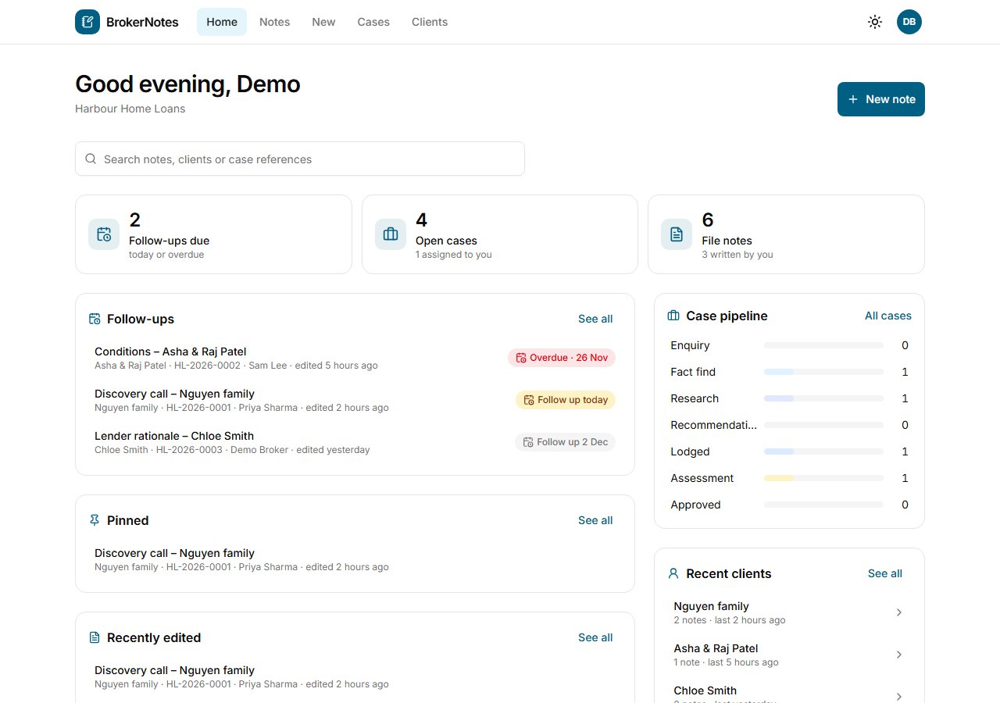 | 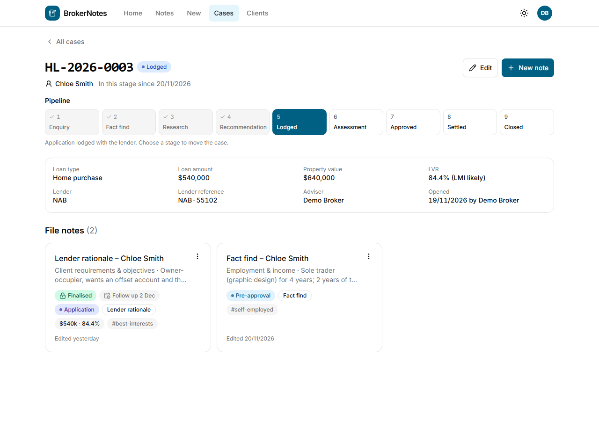 | 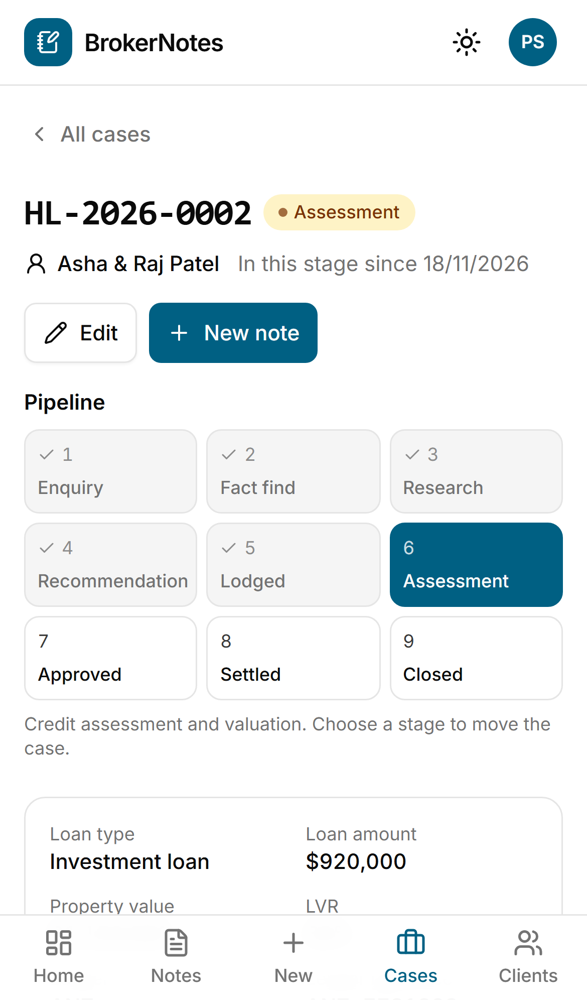 |

| Notes list                                                      | Tiptap editor                                               | AI assist                                                     |
| --------------------------------------------------------------- | ----------------------------------------------------------- | ------------------------------------------------------------- |
| 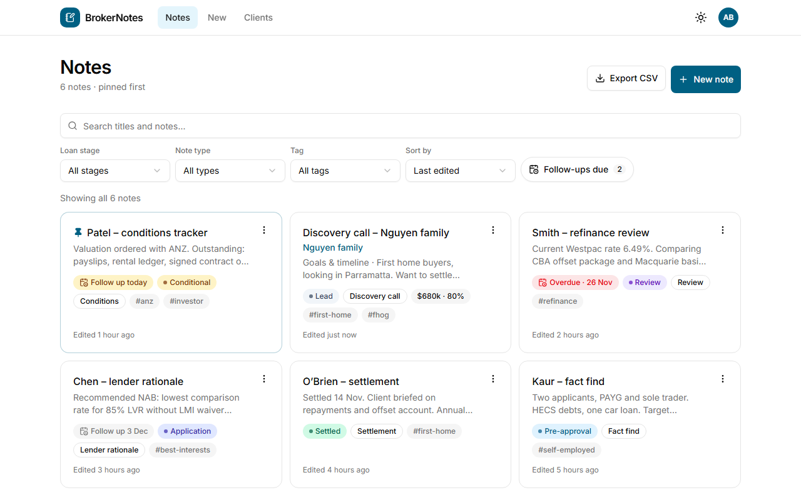 | 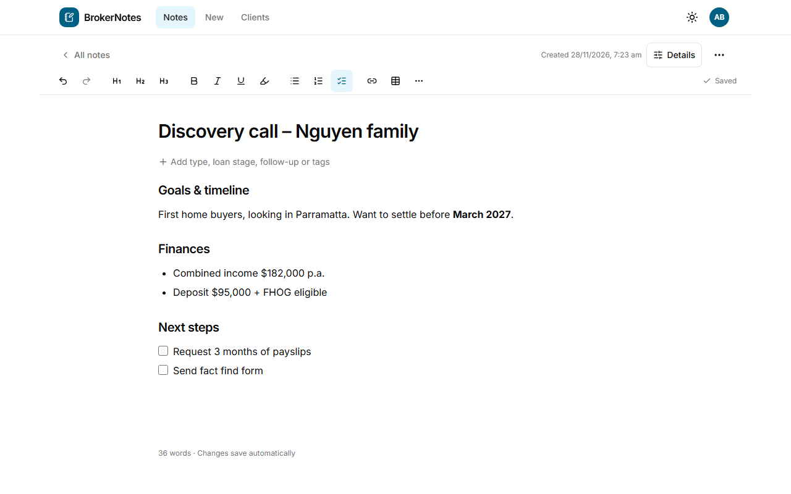 | 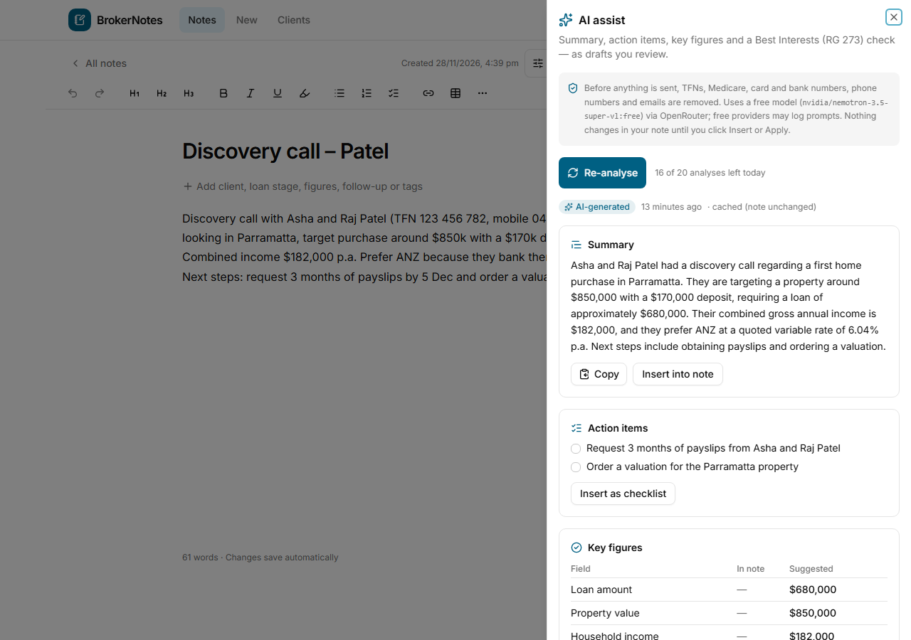 |

| Mobile list                                                    | Mobile editor                                              | Finalised note + amendment                                     | Clients                                                     |
| -------------------------------------------------------------- | ---------------------------------------------------------- | -------------------------------------------------------------- | ----------------------------------------------------------- |
| 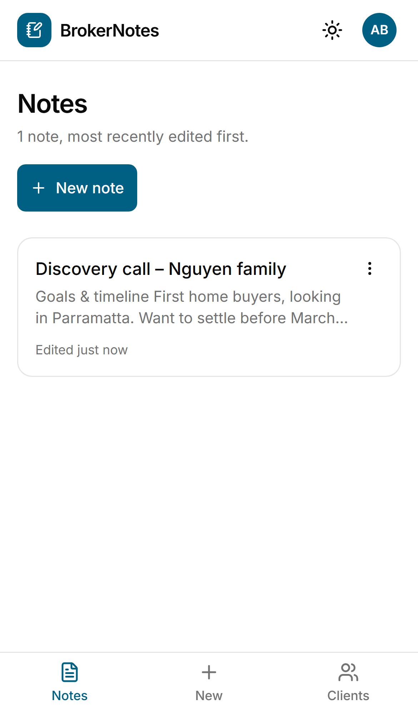 | 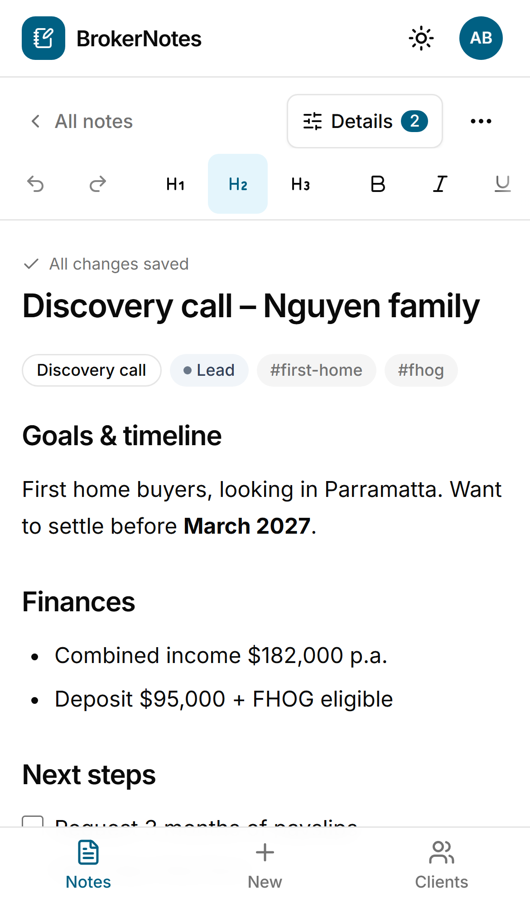 | 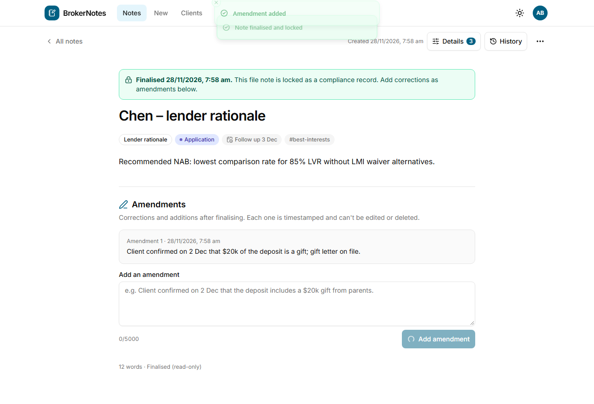 | 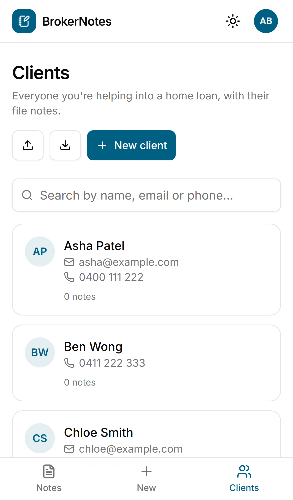 |

---

## The assignment

> Create a Next.js application where the user can take notes and view the list of their notes. The note editor
> should use the Tiptap editor plugin. You should use AI to code this. Consider the user base as mortgage brokers.

**What I built:** a full-stack app with a **Next.js + Tiptap** frontend and a separate **NestJS** API, designed
around how **Australian mortgage brokers** actually use file notes.

## Who it's for, and why it's shaped this way

Before writing code, I used AI research agents to study mortgage-broker workflows and the companies behind
the assignment. The findings shaped the product:

- **Australian brokers must keep file notes.** Under ASIC's **Best Interests Duty (RG 273)**, notes must be
  written at the time, record the client's requirements, the options compared, why the recommended product
  suits, and why the alternatives weren't chosen. ASIC criticises boilerplate notes.
- **Notes are part of a pipeline.** Brokers think in clients and loan stages (lead → pre-approval →
  conditional → settled → review), follow-ups, conditions and key figures (loan amount, LVR, rate, lender).
- **Brokers work on the move**, between client meetings, so the app is **mobile-first**.

## Features

**✍️ Notes (Tiptap editor)**

- **Formatting:** headings, bold, italic, underline, strikethrough and highlight; bullet, numbered and **checklist** lists; **tables** for lender comparisons; links; Markdown shortcuts; word count.
- **Autosave you can trust:** saves after a short pause, **at least every 5 seconds while typing**, and **when the app is backgrounded on a phone**. Ctrl+S saves straight away, a failed save offers retry, and the browser warns before you leave with unsaved changes.
- **Mobile-first:** the toolbar sticks to the top and scrolls sideways, with 44px touch targets.

**🗂️ Notes list**

- **Search** across title, body and client name, with highlighted matches.
- **Filters:** loan stage, note type, tag and client. **Sort:** last edited, created, follow-up date or A–Z.
- **Pinned notes first**, plus a **"Follow-ups due"** view (overdue and today, on the Sydney calendar, daylight saving included).
- **Shareable URLs:** filter state lives in the URL, so a filtered view can be bookmarked or sent.

**🏦 Broker features**

- **Clients:** client records with a timeline of their notes.
- **Templates:** 6 broker templates (discovery call, fact find, **best-interests / lender rationale**, conditions tracker, settlement, annual review).
- **Key loan figures:** type `850k` or `$1.2m`. **LVR is calculated automatically**, with a hint when LMI is likely.
- **Finalise:** locks a note as a compliance record, **enforced by the server**. Later corrections are **timestamped, append-only amendments**.
- **Version history:** preview earlier versions and restore one. Delete is a **soft delete**, so records are retained.
- **CSV:** export notes (respecting the current filters) and clients. Import clients with column matching, a preview, and duplicates skipped rather than overwritten. Exports are **Excel-safe**, with a formula-injection guard.

**🏠 Dashboard and mortgage cases**

- **Dashboard** (the landing page): follow-ups due, open cases (and yours), pinned and recently edited notes, recent clients, the **case pipeline** by stage, quick search and quick-create.
- **Mortgage cases:** one loan for one client, with an automatic reference (`HL-2026-0007`), loan type, lender and lender reference, amounts with **LVR**, and an assigned adviser.
- **Nine-stage pipeline** (from the product research, in Australian terms): Enquiry → Fact find → Research → Recommendation → Lodged → Assessment → Approved → Settled → Closed. One click moves a case, and every move is audited. **Case managers can move stages** (tracking progress is their job), but only admins and advisers open cases or change their details.
- **Notes belong to cases:** write a note from a case, or link one in the details panel. Linking also sets the client. Each case page is a **timeline of its notes**, notes can be searched by case reference, and the notes CSV includes the case.

**✅ Follow-up tasks**

- **Tasks** have a title, due date (a Sydney calendar day), priority, assignee and status (to do, in progress, done or cancelled), and can be linked to a **note, client and/or case**. A note brings its client and case; a case brings its client.
- **One click from a note:** turn its **unticked checklist** into tasks (no duplicates), or create tasks from the **AI action items**.
- **Where they appear:** a **Tasks** page (assigned to me, all open, unassigned, done, plus overdue / today / next 7 days and search), a Tasks panel on every note, open tasks on case and client pages, and **My tasks** on the dashboard. Tick a task to complete it.

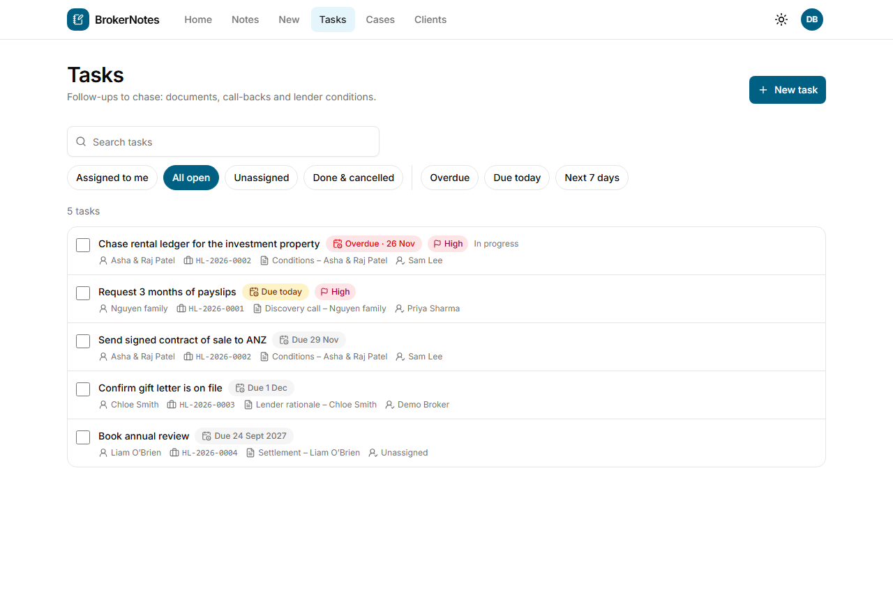
- **Who can change a task:** anyone can create one (case managers chase documents); only its creator, its assignee or an admin can change it. Tasks are never deleted, only cancelled, and every change is audited.

**👥 Brokerages, roles and audit log**

- **Organisations:** registering creates a brokerage with you as its **Admin**. Everyone in it shares the brokerage's clients and notes, and nobody outside it can see them.
- **Roles:** **Admin** (manages the team and can edit any note), **Adviser** (works with clients and edits their own notes) and **Case manager** (reads everything and writes their own updates, but can't change client records or export).
- **Invites:** admins create a **single-use invite link** (bound to an email, valid for 7 days, only a hash stored) and send it themselves, since there's no email service.
- **Read-only for others:** a note shows its **author**. Other members see it **view-only**, enforced by the API, not just hidden in the UI. Use **"Created by me"** to filter to your own notes.
- **Role changes and deactivation apply immediately:** the API re-reads the member on every request. A brokerage can never lose its last active admin.
- **Audit log:** an append-only record of important actions (sign-ins, notes created, finalised, amended or deleted, client changes, exports, AI use, team changes), filterable by category. Content autosaves are deliberately left out, because version history covers them.

**✨ AI assist (free models only)**

- One click returns a **summary**, **action items** (insertable as a checklist), **key figures** (applied in one click) and an **RG 273 Best Interests check**.
- **Privacy:** TFNs, Medicare, card and bank numbers, phone numbers and emails are **removed on the server before anything is sent**, and the panel shows what was removed.
- **Free OpenRouter models only:** a paid model id is ignored. Results are cached until the note changes, with **20 analyses per broker per day**.
- **Drafts only:** results are labelled _AI-generated_, and nothing changes in the note until you click _Insert_ or _Apply_.

## Architecture

```
broker-notes/
├─ apps/
│  ├─ web/      Next.js 15: UI only (Tiptap, pages, mobile). No database access.
│  └─ api/      NestJS 11 REST API: auth, notes, clients, CSV, AI, Prisma → Postgres. Swagger at /docs.
└─ packages/
   └─ shared/   Zod schemas, API types and pure business logic used by both apps (CJS + ESM builds).
```

```
Browser ─► Next.js (apps/web) ─/api/* proxy─► NestJS (apps/api) ─► Postgres (Neon)
              ├─ server components call the API directly, forwarding the session cookie
              └─ middleware verifies the session JWT for page routing (the API authorises every request)
```

|              |                                                                                                   |
| ------------ | ------------------------------------------------------------------------------------------------- |
| **Frontend** | Next.js 15 (App Router), React 19, Tiptap 3, Tailwind v4, shadcn/ui, light/dark                   |
| **Backend**  | NestJS 11, Prisma 6, Postgres (Neon), Zod validation, Swagger/OpenAPI, Helmet, rate limiting      |
| **Auth**     | bcrypt + JWT in an **httpOnly, SameSite=Lax** cookie, through a same-origin proxy (no CORS)       |
| **AI**       | OpenRouter `:free` models (Nemotron 3.5 Super, Gemma fallbacks), one structured call per analysis |
| **Shared**   | One set of Zod schemas validates the forms _and_ the API, so the two can never disagree           |
| **Hosting**  | Vercel (web), Render (API), Neon (DB): see [docs/DEPLOYMENT.md](docs/DEPLOYMENT.md)               |

## Security and privacy

- **Isolation:** every query is scoped to the member's **brokerage**. Another brokerage's note, client, member,
  invite or audit entry returns **404**, for every action (integration-tested).
- **Roles:** enforced on the server for every write. A member who isn't allowed gets **403**, so hiding a
  control in the UI is never the only safeguard.
- **Auth:** bcrypt (cost 12), login timing that doesn't reveal which emails exist, generic error messages,
  **10 attempts/min per IP**, and redirects restricted to this site.
- **Compliance:** the finalise lock and soft delete are enforced on the server. Amendments are append-only,
  and version history is kept.
- **AI:** identifiers are redacted server-side, models are free-only, and AI output is draft-only, with daily
  and per-minute limits.
- **Data hygiene:** inputs are validated with size limits, CSV exports can't trigger formulas, and secrets
  live only in `.env` files.
- **CI security:** CodeQL, dependency review and npm audit run on every PR.

## Getting started

Requirements: Node 20.9+ and a Postgres database (for example a free [Neon](https://neon.tech) project).

```bash
npm install

# 1. Configure both apps (AUTH_SECRET must be the same value in both)
cp apps/api/.env.example apps/api/.env   # DATABASE_URL, DIRECT_URL, AUTH_SECRET (+ OPENROUTER_API_KEY for AI)
cp apps/web/.env.example apps/web/.env   # API_URL, AUTH_SECRET

# 2. Create the tables and the demo account
npm run db:migrate
npm run db:seed        # demo@brokernotes.dev / demo1234

# 3. Run shared (watch) + API (:4000) + web (:3000)
npm run dev
```

The app opens at http://localhost:3000 and the API docs at http://localhost:4000/docs.

| Command                                 | What it does                                                       |
| --------------------------------------- | ------------------------------------------------------------------ |
| `npm run dev`                           | shared + API + web in watch mode                                   |
| `npm run build`                         | Build shared, then the API, then the web app                       |
| `npm run check`                         | Lint, typecheck, unit tests and format check across all workspaces |
| `npm test`                              | Unit tests: shared (Vitest), web (Vitest), API (Jest)              |
| `npm run test:int -w @broker-notes/api` | API integration tests over HTTP against a real Postgres            |
| `npm run test:e2e`                      | Playwright E2E (desktop + mobile); starts the API and the web app  |
| `npm run db:seed`                       | (Re)create the demo brokerage (admin, adviser, case manager)       |

## Testing

| Layer             | Tooling                     | Covers                                                                                                                                           |
| ----------------- | --------------------------- | ------------------------------------------------------------------------------------------------------------------------------------------------ |
| Shared logic      | Vitest (130+ tests)         | Filters, Sydney dates and daylight saving, money and LVR, CSV safety, templates, lock rules, AI redaction and parsing                            |
| Web               | Vitest                      | Route guard, session JWT verification, ordered request queue, autosave timing                                                                    |
| API (integration) | Jest + supertest + Postgres | Auth and rate limits, **brokerage isolation**, roles and invites, cases, **tasks** and the dashboard, the audit log, the note lifecycle, CSV, AI |
| End to end        | Playwright                  | Real browser flows on **desktop and mobile** across both apps, including AI (mock provider)                                                      |

**CI** (GitHub Actions) runs lint, format, typecheck, unit tests, a **database migration and drift check**,
**API integration tests on Postgres 17**, the build, **E2E**, CodeQL, dependency review and npm audit. A single
**✅ CI passed** check is required before anything merges into `main`.

## How AI was used to build this

The assignment asked for AI-assisted development. This project was built with **Claude Code** as a pair
programmer, and the human (me) owned direction and review:

1. **Research.** Parallel AI research agents studied broker workflows and Australian compliance (RG 273),
   plus the hiring context. The findings set the product direction above.
2. **Plan.** The AI drafted a phased plan with "done when" criteria. I adjusted scope: OpenRouter with free
   models only, mobile-first, CSV, a PR per phase, and later **a separate NestJS backend**.
3. **Build, one PR per phase.** Each phase was a branch with small conventional commits and a detailed PR
   (summary, screenshots, how to test, checklist). **I reviewed and merged every PR myself.**
4. **Verify.** The AI wrote unit, integration and E2E tests alongside the code and reviewed real screenshots.
   That process caught real bugs before review, including:
   - formatted notes failing to save (ProseMirror attributes the serializer couldn't send)
   - autosave never firing during continuous typing
   - version history losing intermediate wording
   - a **request-ordering race** after the backend split (two quick edits landing out of order)
   - a Zod bundle leak that added about 100 kB to every page
   - a CodeQL prototype-pollution finding
   - a reasoning model returning empty replies under too small a token budget

The full decision log and a prompt-by-prompt **AI usage log** are in [`SCRATCHPAD.md`](SCRATCHPAD.md).
Every phase's PR is in the [closed pull requests](https://github.com/Grohit22013/broker-notes/pulls?q=is%3Apr+is%3Aclosed+Phase).

## Key design decisions

| Decision                                                   | Why                                                                                                             |
| ---------------------------------------------------------- | --------------------------------------------------------------------------------------------------------------- |
| Separate **NestJS API** + Next.js UI in a **monorepo**     | Clear frontend/backend boundary, with shared schemas and types so the two can't drift apart                     |
| **Australian** focus, built around RG 273                  | Matches the hiring context, and gives the notes a compliance purpose beyond plain text                          |
| Tiptap JSON **plus** a plain-text copy                     | JSON keeps formatting exact; the text copy powers search, snippets and AI                                       |
| Finalise lock + amendments, soft delete                    | A compliance record must never be silently rewritten or removed                                                 |
| Follow-ups as **Sydney calendar days**                     | "Due today" must match the broker's day, not the server's UTC day                                               |
| **One** structured AI call, cached, free models, redaction | Lowest cost and risk; no multi-step agent for a single-note task                                                |
| **Ordered** browser mutations                              | `fetch` runs in parallel; edits must land in the order they were made                                           |
| Mobile-first, accessible                                   | Brokers write notes between meetings; every control has an accessible name and 44px targets                     |
| Cases separate from notes; a case fixes its client         | A deal has its own lifecycle; notes stay the evidence. Linking a note to a case can't leave a mismatched client |
| Roles checked against the **database** on every request    | A demoted or deactivated member loses access at once, not when their session token expires                      |
| Invite **links**, not emails                               | No email provider needed; single-use, expiring, email-bound tokens, stored only as hashes                       |

## Limitations and next steps

- No "forgot password" or email verification (no email provider). Invites are links that the admin sends themselves.
- One brokerage per account. Someone who already has an account can't be invited into a second brokerage.
- File attachments aren't supported, because they need paid file storage.
- Render's free plan sleeps when idle; the keep-warm workflow helps during business hours.
- Free AI models can be rate-limited upstream. The app falls back across free models and explains when it's busy.
- Filter chips on server-rendered list pages use plain links (a full page load), because in production builds Next.js 15.5 sometimes never applies a client navigation that only changes the query string. See SCRATCHPAD "Open issues".
- Coming next (from the product research): editor extras such as edit-conflict detection and draft recovery (Phase 11).
